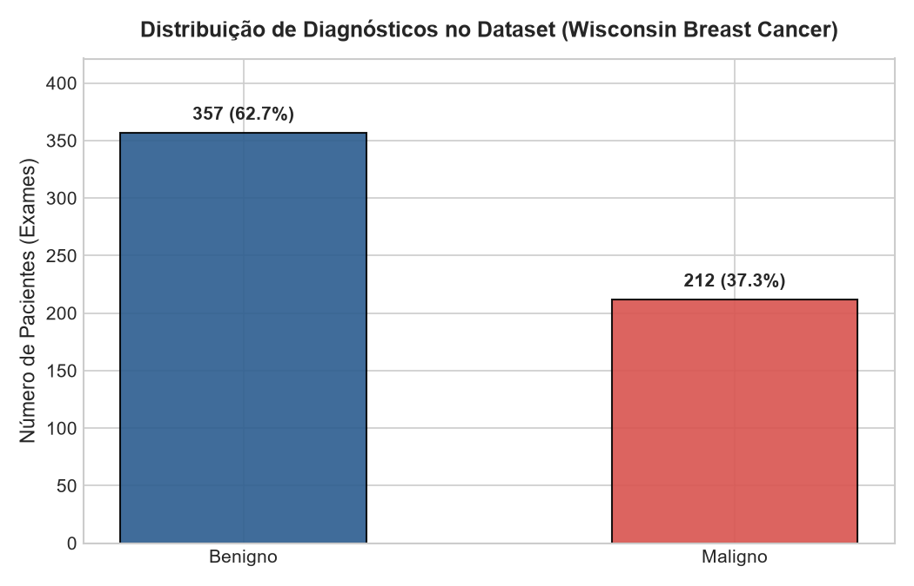
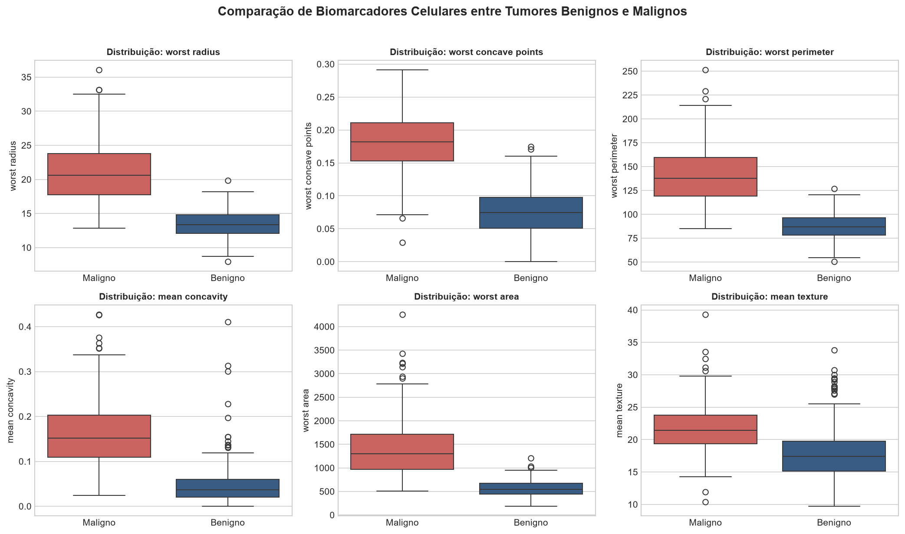
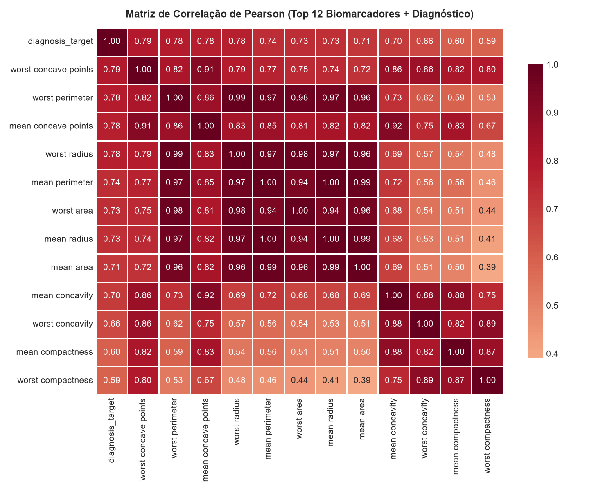
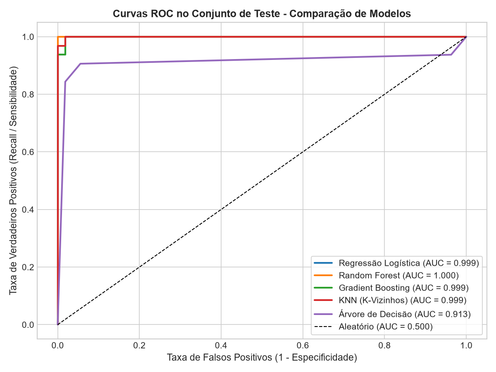
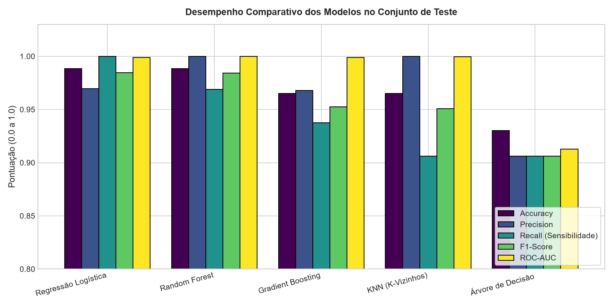
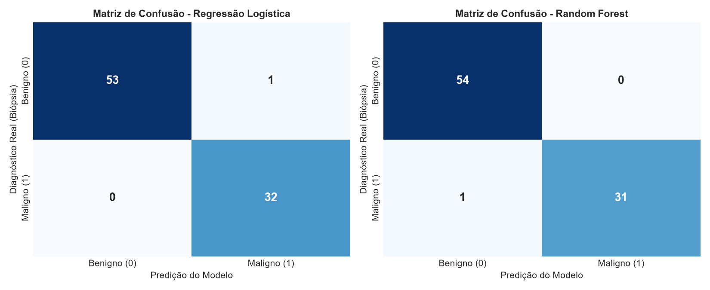
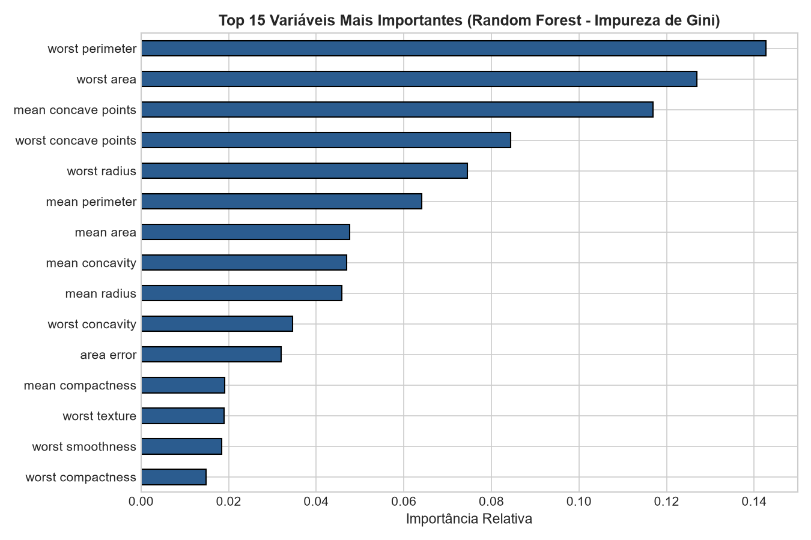
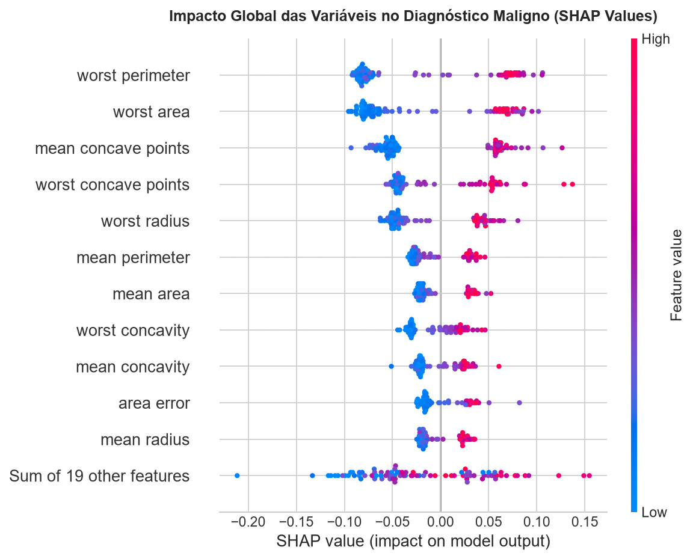
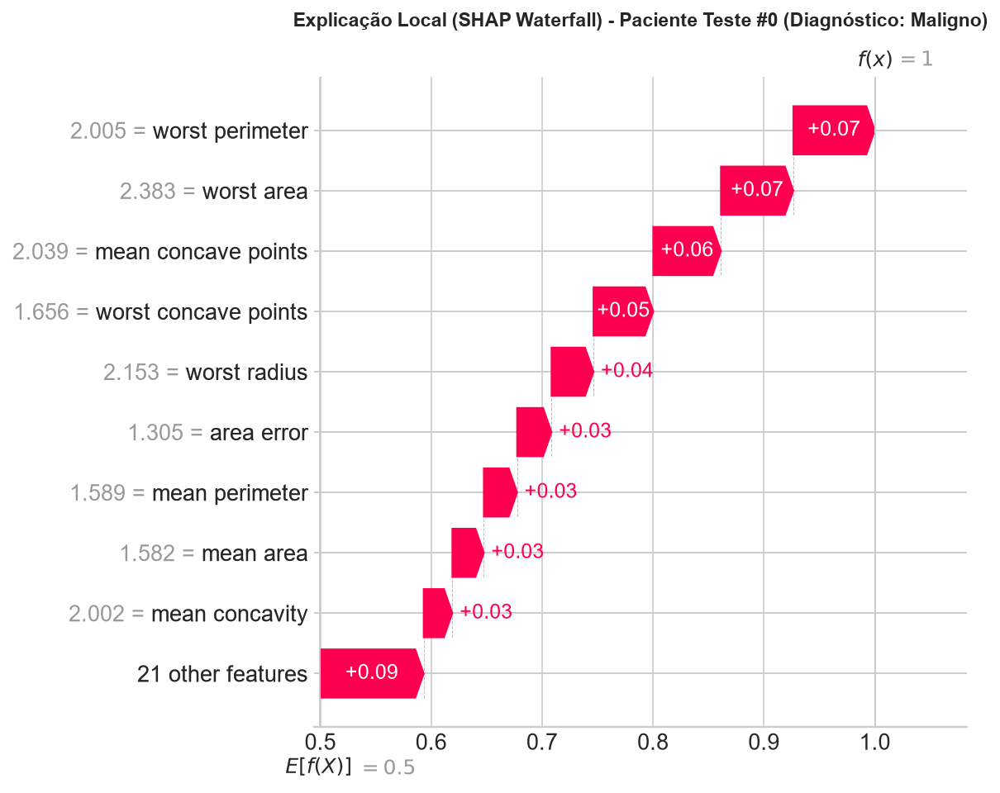

# 🏥 Sistema Inteligente de Suporte ao Diagnóstico Médico (Câncer de Mama)
**POSTECH - Tech Challenge | Fase 1**

Este repositório contém a solução completa para o **Tech Challenge da Fase 1**, cujo objetivo é construir a base de um **Sistema Inteligente de Suporte ao Diagnóstico (CDSS)** focado em **Machine Learning** e **Explicabilidade Clínica (SHAP)** para auxiliar médicos patologistas e oncologistas na triagem de exames de **Câncer de Mama**.

* 🎥 **Vídeo de Demonstração (YouTube):** [https://youtu.be/0msh19j3a9A](https://youtu.be/0msh19j3a9A)
* 📄 **Relatório Técnico Oficial (PDF):** [`Relatorio_Tecnico_Fase1.pdf`](Relatorio_Tecnico_Fase1.pdf)

---

## 🎯 1. Visão Geral e Problema Clínico

Com o volume crescente de exames em hospitais universitários, atrasos na triagem de biópsias podem impactar o prognóstico de pacientes oncológicos. Utilizamos a base pública **Breast Cancer Wisconsin (Diagnostic) Dataset** ([UCI Machine Learning Repository / Kaggle](https://www.kaggle.com/datasets/uciml/breast-cancer-wisconsin-data/data)), composta por **569 exames** e **30 características morfométricas nucleares** extraídas de imagens digitalizadas de biópsias por Punção Aspirativa por Agulha Fina (PAAF / FNA).

* **Variável Alvo (`diagnosis_target`):**
  * `1` = **Maligno** (Presença da doença / Câncer confirmado — 212 casos / 37,26%)
  * `0` = **Benigno** (Ausência de malignidade — 357 casos / 62,74%)

> **🩺 Premissa Ética e Regulatória (Human-in-the-Loop):** O modelo atua exclusivamente como ferramenta de **triagem prioritária e segunda opinião automatizada**. **O médico responsável sempre detém a palavra final no diagnóstico e na conduta clínica.**

---

## 🗂️ 2. Estrutura do Projeto

```text
├── app.py                              # Dashboard interativo em Streamlit (Triagem Clínica + SHAP em tempo real)
├── Dockerfile                          # Containerização completa da aplicação e do pipeline
├── requirements.txt                    # Dependências Python do projeto
├── README.md                           # Documentação técnica e instruções de execução
├── Relatorio_Tecnico_Fase1.pdf         # Entregável oficial em PDF com links, gráficos e relatório técnico
├── data/
│   └── breast_cancer_wisconsin.csv     # Base de dados tabular estruturada (569 exames x 32 colunas)
├── models/
│   ├── trained_pipelines.joblib        # Pipelines completos (Pré-processamento + 5 Modelos treinados)
│   └── data_splits.joblib              # Conjuntos estratificados de Treino (70%), Validação (15%) e Teste (15%)
├── notebooks/
│   └── Tech_Challenge_Fase_1.ipynb     # Notebook Jupyter completo e executado com todas as análises
├── outputs/
│   ├── metrics_summary.json            # Métricas detalhadas de validação e teste
│   └── figures/                        # Gráficos gerados (EDA, Correlação, ROC, Matrizes de Confusão, SHAP)
└── src/
    ├── train_pipeline.py               # Script de engenharia de dados, treinamento, avaliação e SHAP
    ├── create_notebook.py              # Gerador automatizado do Notebook Jupyter
    └── generate_pdf_report.py          # Gerador do Relatório Técnico em PDF
```

---

## ⚙️ 3. Estratégias de Pré-processamento e Modelagem

1. **Limpeza e Integridade dos Dados:** Verificação de valores ausentes (0 registros nulos) e duplicatas (0 duplicatas).
2. **Separação Clara e Estratificada:**
   * **Treino (70% - 398 exames):** Aprendizado dos parâmetros e validação cruzada estratificada (*5-Fold Stratified Cross-Validation*).
   * **Validação (15% - 85 exames):** Seleção de modelos e calibragem de limiar de decisão (*threshold*).
   * **Teste (15% - 86 exames):** Avaliação final cega em dados inéditos.
3. **Pipeline em Python (`ColumnTransformer` + `Pipeline`):**
   * **Variáveis Numéricas:** Imputação preventiva pela mediana (`SimpleImputer(strategy="median")`) seguida de padronização Z-score (`StandardScaler()`), essencial para modelos sensíveis à escala como Regressão Logística e KNN.
   * **Variáveis Categóricas:** No notebook demonstramos também a codificação via `OneHotEncoder` integrado ao `ColumnTransformer` sem vazamento de dados (*data leakage*).

---

## 📊 4. Resultados Obtidos no Conjunto de Teste

Em triagem oncológica, o erro mais crítico é o **Falso Negativo** (classificar um tumor maligno como benigno, atrasando o tratamento). Portanto, priorizamos o **Recall (Sensibilidade)** aliado ao **F1-Score** e **ROC-AUC**:

| Modelo | Accuracy (Teste) | Recall / Sensibilidade | Precision | F1-Score | ROC-AUC | Recall Médio (5-Fold CV) |
| :--- | :---: | :---: | :---: | :---: | :---: | :---: |
| **Regressão Logística** | **98,84%** | **100,00%** (32/32) | 96,97% | **98,46%** | 0,9988 | **95,93%** |
| **Random Forest** | **98,84%** | 96,88% (31/32) | **100,00%** | 98,41% | **1,0000** | 93,86% |
| **Gradient Boosting** | 96,51% | 93,75% (30/32) | 96,77% | 95,24% | 0,9988 | 90,46% |
| **KNN (K-Vizinhos)** | 96,51% | 90,62% (29/32) | **100,00%** | 95,08% | 0,9994 | 92,51% |
| **Árvore de Decisão** | 93,02% | 90,62% (29/32) | 90,62% | 90,62% | 0,9126 | 91,84% |

### Principais Gráficos e Análises Geradas (`outputs/figures/`)

#### 1. Exploração de Dados e Matriz de Correlação




#### 2. Desempenho dos Modelos, Curvas ROC e Matrizes de Confusão




#### 3. Interpretabilidade Clínica: Feature Importance e SHAP (Global & Paciente Individual)




---

## 📋 5. Relatório Técnico: Modelos, Métricas e Discussão Crítica

### Por que escolhemos esses 5 modelos?
* **Regressão Logística (`class_weight="balanced"`):** Modelo linear probabilístico de alta interpretabilidade e excelente calibragem em espaços padronizados via Z-score.
* **Random Forest Classifier (200 árvores):** Ensemble via *bagging* capaz de capturar interações não-lineares complexas e altamente resistente à multicolinearidade observada entre `radius`, `perimeter` e `area`.
* **Gradient Boosting Classifier:** Ensemble sequencial baseado em *boosting* de gradiente focado na redução iterativa de erros residuais.
* **KNN (`k=7`, ponderado pela distância):** Algoritmo não-paramétrico baseado em proximidade geométrica de prontuários.
* **Árvore de Decisão:** Modelo *baseline* de regras hierárquicas diretas.

### Escolha da Métrica no Contexto Médico (Por que priorizar o Recall?)
Em triagem oncológica, um **Falso Negativo** (classificar um tumor **Maligno** como **Benigno**) é o erro mais grave possível, pois retarda o diagnóstico definitivo e o início do tratamento do paciente. Já um **Falso Positivo** encaminha o exame para revisão prioritária pelo médico patologista sem risco à vida.
Por isso, priorizamos o **Recall (Sensibilidade)** combinado ao **F1-Score** e **ROC-AUC**. A **Regressão Logística** atingiu **100,00% de Recall** no conjunto de teste (detectando todos os 32 casos malignos sem nenhum falso negativo), enquanto o **Random Forest** alcançou **100,00% de Precisão**, **96,88% de Recall** e **ROC-AUC = 1,0000**.

### Aplicação Prática no Hospital e Papel do Médico
O modelo pode ser utilizado diretamente na prática hospitalar como um **Sistema de Suporte à Decisão Clínica (CDSS)** para **triagem inteligente e priorização de filas**:
1. **Priorização Automática:** Ao processar os dados morfométricos da lâmina de PAAF, exames com probabilidade $\ge 0,40$ recebem alerta de alta prioridade na fila do patologista.
2. **Auditoria Visual (SHAP):** O médico visualiza no Dashboard (`app.py`) exatamente quais biomarcadores celulares (`worst perimeter`, `worst area`, `worst concave points`) motivaram o alerta.
3. **Soberania Médica (*Human-in-the-Loop*):** A IA atua como segunda opinião para acelerar a triagem e reduzir erros por fadiga, mas **o médico especialista sempre tem a palavra final no diagnóstico**, integrando o resultado com exame físico, exames de imagem (BI-RADS), histórico clínico e imuno-histoquímica.

---

## 🚀 6. Instruções de Execução

### Opção A: Execução Local (Python)

1. Crie e ative um ambiente virtual (opcional, mas recomendado):
   ```bash
   python -m venv .venv
   # No Windows (PowerShell):
   .\.venv\Scripts\Activate.ps1
   # No Linux/macOS:
   source .venv/bin/activate
   ```
2. Instale as dependências:
   ```bash
   pip install -r requirements.txt
   ```
3. Execute o pipeline de treinamento e geração de gráficos/SHAP:
   ```bash
   python src/train_pipeline.py
   ```
4. Inicie o **Dashboard Interativo de Triagem Médica (Streamlit)**:
   ```bash
   streamlit run app.py
   ```
   O sistema abrirá automaticamente no navegador em `http://localhost:8501`.
5. Para abrir o **Notebook Jupyter**:
   ```bash
   jupyter notebook notebooks/Tech_Challenge_Fase_1.ipynb
   ```

### Opção B: Execução via Docker

1. Construa a imagem Docker:
   ```bash
   docker build -t cdss-breast-cancer:fase1 .
   ```
2. Execute o container expondo a porta `8501`:
   ```bash
   docker run -p 8501:8501 cdss-breast-cancer:fase1
   ```
3. Acesse `http://localhost:8501` no seu navegador.
